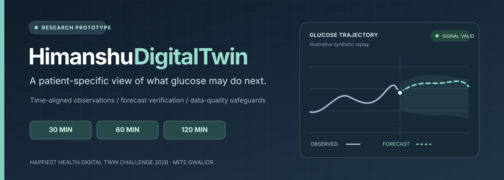
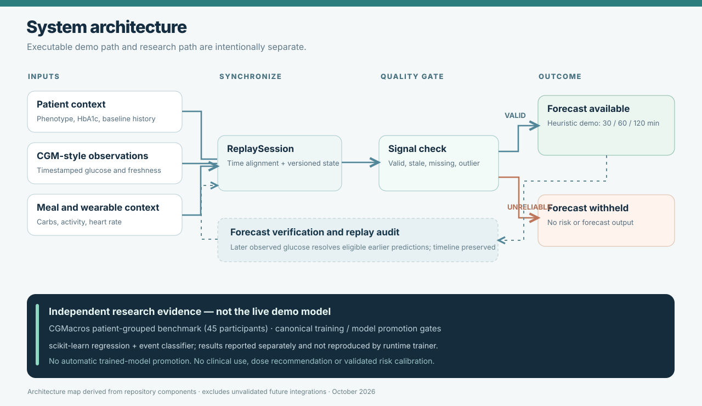
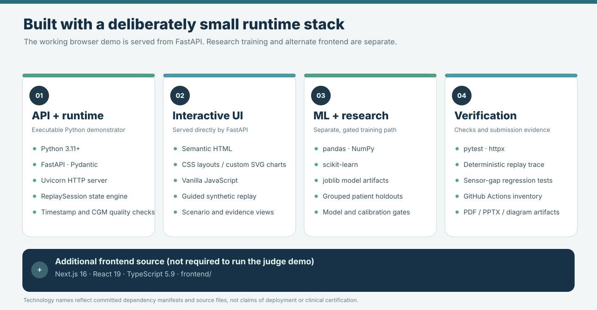
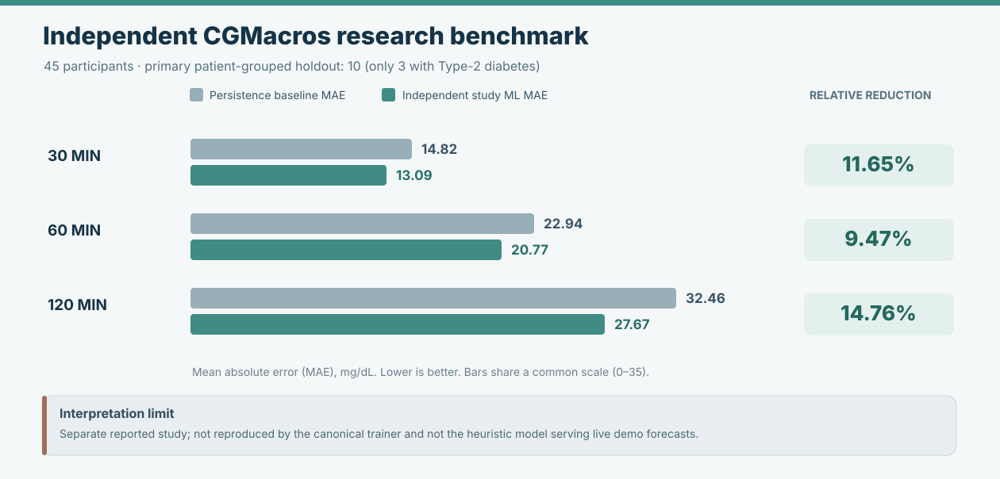

# HimanshuDigitalTwin



[**Judge quick start**](JUDGE_START_HERE.md) · [**Architecture**](docs/ARCHITECTURE_AND_MODELS.md) · [**Presentation PDF**](submission/HimanshuDigitalTwin_Presentation.pdf) · [**Research evidence**](submission/JUDGE_EVIDENCE_INDEX.md) · [**Submission status**](SUBMISSION_CHECKLIST.md)

**Team:** himanshusubh1510  
**Presenter:** Himanshu Shukla  
**College:** Madhav Institute of Technology and Science (MITS), Gwalior  
**Competition:** Happiest Health Digital Twin Challenge 2026  
**Project:** Patient-specific glucose forecasting and sensor-quality-aware monitoring

> **Research demonstration, not a clinical device.** The interactive walkthrough uses simulated patient observations and illustrative, uncalibrated forecasts. It must not be used for diagnosis, treatment or insulin dosing.

| What you can inspect | Current evidence |
|---|---|
| **Working browser demonstration** | Six deterministic simulated replay chapters, including sensor-gap abstention and recovery |
| **Forecast scope** | 30-, 60-, 120-minute research scenarios and an illustrative two-hour excursion warning target |
| **Research benchmark** | A separate patient-grouped CGMacros experiment; **not** the active demo forecaster |
| **Submission state** | GitHub source and diagrams available; unlisted video, registered roster and Unstop acceptance are **not confirmed** |

## The problem

A glucose reading describes the **present**, but not what will happen after a meal or physical activity. Patient phenotype, historical glucose patterns, incoming continuous glucose monitoring (CGM) readings, meal context and activity can all affect near-term behavior. Missing or stale sensor values make a plausible-looking prediction particularly misleading.

**Target healthcare use case:** Type-2 diabetes research support. The prototype explores glucose trajectories over **30, 60 and 120 minutes** and a research warning target: onset of a *new* glucose excursion above 180 mg/dL within the next two hours. The warning is **not** an approved or clinically calibrated alert.

## What the prototype does

The demonstrator combines baseline patient context with time-stamped sensor-style observations, updates a patient-specific digital state, displays a forecast and contextual contributors, and records outcomes for later comparison. It **withholds the forecast and risk** during the demonstrated stale-sensor condition. Within a short sensor gap (up to the 15-minute freshness rule), estimates may still be generated using the last valid reading; these are **extrapolations**, not fresh CGM observations. The public chart hides imputed values and visibly distinguishes the sensor state. The guided replay is deterministic and uses **synthetic data**, so judges can run it without downloading medical records.

## System architecture



The default application runs a synthetic replay through `ReplaySession`, now isolated into independent ephemeral states per anonymous browser. Timestamped phenotype, CGM-style readings, meals and activity are converted into a versioned state. A sensor-quality check may deliberately suppress forecasts and risk output. Independent research training artifacts are kept separate from the live heuristic demonstration.

[**Implementation map, model boundaries and key API routes →**](docs/ARCHITECTURE_AND_MODELS.md) · [**Critical readiness audit →**](docs/TECHNICAL_AUDIT.md)

### Start the working prototype

Requires Python 3.11 or newer.

```bash
cd backend
python -m pip install -r requirements.txt
python -m uvicorn app.main:app --host 127.0.0.1 --port 8000
```

Open **http://127.0.0.1:8000** and select the **Guided judge demo**. Explore a valid forecast, sensor-data loss, forecast abstention and recovery.

## Technical stack



**Default demo:** `backend/app/` and `backend/static/` run together under FastAPI. **Alternate frontend:** `frontend/` contains a separate Next.js/React interface and is not required for the judge walkthrough. The research pipeline is **not** automatically deployed or promoted into either interface.

| Layer | Technology and purpose |
|---|---|
| API and backend | Python, FastAPI, Pydantic, Uvicorn |
| Demonstrator UI | HTML, CSS and JavaScript served by FastAPI |
| Additional frontend source | Next.js, React and TypeScript (not required to run the guided demo) |
| Data processing | pandas, NumPy; CGMacros and ShanghaiT2DM research adapters |
| Machine-learning pipeline | scikit-learn, joblib; training-only feature imputation and subject-grouped evaluation |
| Validation | pytest, API checks, sensor-quality and promotion-gate regression tests |

### AI / ML models and framework

The **canonical research training implementation** uses `HistGradientBoostingRegressor` for 30/60/120-minute glucose estimates and `LogisticRegression` for the binary onset-event research task. It uses **patient-grouped training/validation folds** and an untouched subject-level holdout, with separate evidence gates for trained-model activation, personalization and uncertainty intervals. The research transport pipeline restricts its features to modalities available in the external cohort.

**Do not confuse these training implementations with the active demo model:** the submitted walkthrough currently runs a clearly labelled **heuristic/simulated forecaster**, not an approved trained research artifact. The canonical trainer has not yet reproduced the results of the separate independent CGMacros benchmark.

### Independent research evidence



A separate experiment involving **45 CGMacros participants** (14 with Type-2 diabetes) reported the following **primary subject-holdout** results. Units are MAE in mg/dL; smaller is better.

| Horizon | Persistence baseline | Study ML model | Relative MAE reduction |
|---|---:|---:|---:|
| 30 min | 14.82 | 13.09 | 11.65% |
| 60 min | 22.94 | 20.77 | 9.47% |
| 120 min | 32.46 | 27.67 | 14.76% |

Only **three Type-2 diabetes participants** were in the primary ten-person holdout; these are **pooled-cohort findings**, not T2D-only or clinical-validation statistics. Personalization and uncertainty intervals did not meet their own acceptance criteria. Shanghai external validation remains incomplete. See [research evidence](backend/reports/research/) and [judge evidence index](submission/JUDGE_EVIDENCE_INDEX.md).

## Repository map

| Path | What it contains |
|---|---|
| [`backend/app/`](backend/app/) | FastAPI routes, synthetic patient stream, replay engine, sensor and model safeguards |
| [`backend/static/`](backend/static/) | Default dashboard, browser interaction and trajectory charts |
| [`backend/scripts/`](backend/scripts/) | Evidence verification, model training tooling and readiness checks |
| [`backend/tests/`](backend/tests/) | Automated replay, input-quality and artifact-gate regression coverage |
| [`frontend/`](frontend/) | Optional Next.js / React / TypeScript interface, **not** the default judge demo |
| [`backend/reports/research/`](backend/reports/research/) | Independent study reports; not original independent training scripts or participant datasets |
| [`docs/assets/`](docs/assets/) | Original, vector README graphics (editable SVG) |
| [`docs/TECHNICAL_AUDIT.md`](docs/TECHNICAL_AUDIT.md) | Confirmed limitations, corrective work, and still-unverified checks |
| [`submission/`](submission/) | Architecture PDF, six-slide deck, demonstration plan, evidence index and metadata |

## Judge verification in one session

Start the demo using the commands above. Select the six **Guided judge demo** chapters and verify that the sensor-gap chapter has an absent glucose value, no forecast, and no excursion risk. The separate study metrics are available for inspection under **Evidence & safety**, but cannot be claimed as live-model accuracy.

From the repository **root**, run:

```bash
python backend/scripts/verify_judge_submission.py
python -m pytest backend/tests -q
python backend/scripts/submission_readiness.py
```

The readiness checker is expected to report **NOT_READY** until the real video and registration/submission attestations exist. Its failure exit code is intentional in that state; it does not mean the replay itself failed. Tests validate software behavior, **not** clinical efficacy.

## Submission files

| Required item | Public repository link |
|---|---|
| Judge quick start | [JUDGE_START_HERE.md](JUDGE_START_HERE.md) |
| Architecture diagram | [PDF](submission/architecture.pdf) · [editable SVG](docs/assets/system-architecture.svg) · [source-component guide](docs/ARCHITECTURE_AND_MODELS.md) |
| Six-slide presentation | [PDF](submission/HimanshuDigitalTwin_Presentation.pdf) · [PPTX](submission/HimanshuDigitalTwin_Presentation.pptx) · [browser source](submission/Presentation.html) |
| Project and outcome explanation | [Presentation overview](submission/PRESENTATION_OVERVIEW.md) |
| Demonstration guidance | [minimum-20-minute recording plan](submission/VIDEO_RECORDING_PLAN.md) |
| Open-source licence | [MIT Licence](LICENSE) |
| Submission acceptance checklist | [SUBMISSION_CHECKLIST.md](SUBMISSION_CHECKLIST.md) |

## Demonstration video — pending

**Demonstration video (minimum 20 minutes): NOT YET PROVIDED.**

The video URL has **not** been supplied or verified. The official public guidelines specify **a minimum duration of 20 minutes**, rather than a 15–20-minute limit. Once the video is genuinely uploaded, add its direct `https://www.youtube.com/watch?v=...` or `https://youtu.be/...` link **here** and in `submission/submission_metadata.json`. Confirm that it is accessible without logging into the uploader's account. Do not treat the recording plan as a substitute for the video.

### Organizer packaging requirement

The challenge instructions specify the folder naming pattern `Team Name_College Name`. The current repository remains named `Himanshu-DigitalTwin`; [the team-and-college submission index](himanshusubh1510_MITS_Gwalior/README.md) groups links using that naming pattern. This index does **not** establish acceptance of the packaging format by the organizer. If the participant dashboard requires the repository itself to be renamed or a specific directory layout, follow those instructions before submission.

## Team, institution and licence

- **Team name:** himanshusubh1510
- **Presenter:** Himanshu Shukla
- **Institution:** Madhav Institute of Technology and Science (MITS), Gwalior
- **Registered leader and complete team roster:** require confirmation against the Unstop registration; not inferred here
- **Incubator:** not confirmed; no incubation claim is made
- **Licence:** [MIT](LICENSE). The third-party research datasets are governed by their own source terms and are not redistributed with the repository.

## Deployment constraint

**This is still a local research demonstration, not a production multi-tenant or clinical service.** Browser visits now get separate, anonymous, short-lived replay states with a server-issued HTTP-only cookie. The in-memory store expires idle sessions after 30 minutes and allows at most 32 per process. Session state remains ephemeral, and a multi-worker deployment would split state across processes. No identity, user authentication, durable audit storage or clinical-data controls have been implemented. **Do not deploy it publicly for patient use.** See the [technical audit](docs/TECHNICAL_AUDIT.md).

## Evidence and safety boundaries

- All values in the default interactive replay are **synthetic**; its heuristic forecasts and displayed risk estimates are **uncalibrated**.
- The independent CGMacros result is from a **separate experiment**, not a trained model promoted into the running demo. Original study training scripts and participant-level data are not provided here.
- The primary study holdout contains only **3 participants with Type-2 diabetes**. Do not treat pooled-cohort accuracy as diabetes-specific or clinical validation.
- Personalization and nominal uncertainty intervals **did not pass** their acceptance gates. Shanghai external validation is **incomplete**.
- No real medical records, identifiable sensor exports, personal credentials, or private dataset contents should be committed to GitHub.

See the [judge evidence index](submission/JUDGE_EVIDENCE_INDEX.md) for what is reproducible and what remains unverified.

**Submission status:** Public project files exist on GitHub. An actual unlisted video link, any missing registered-team details, and confirmation of the competition-platform submission are still pending. See [SUBMISSION_CHECKLIST.md](SUBMISSION_CHECKLIST.md).
