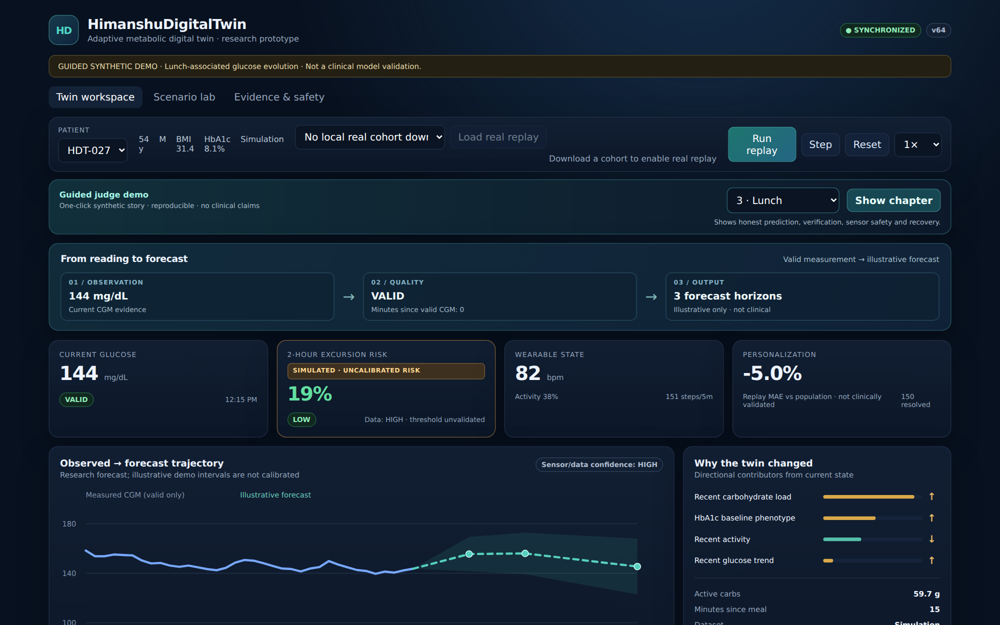
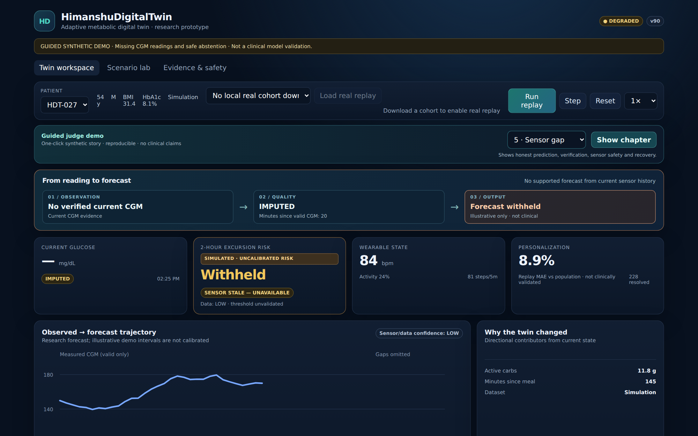

# HimanshuDigitalTwin

**A glucose digital-twin research prototype that knows when not to predict.**  
Happiest Health Digital Twin Challenge 2026 · **Team:** `himanshusubh1510` · **Presenter:** Himanshu Shukla · **College:** MITS Gwalior

**What is working:** A deterministic, browser-based **synthetic** patient replay that combines patient history, glucose readings, meals and wearable activity; updates patient state; generates illustrative 30/60/120-minute forecasts; checks earlier predictions against later observations; and **withholds predictions when the sensor data is too stale**.

**What it is not:** A clinically validated glucose predictor, medical device, insulin-dosing tool or public patient-record service. The independently reported research results below are **not** the performance of the running demo.

[**Judge's 2-minute guide**](JUDGE_START_HERE.md) · [**Six-slide PDF**](submission/HimanshuDigitalTwin_Presentation.pdf) · [**Editable PPTX**](submission/HimanshuDigitalTwin_Presentation.pptx) · [**Evidence & limits**](submission/JUDGE_EVIDENCE_INDEX.md) · [**Submission status**](SUBMISSION_CHECKLIST.md)

## The working prototype

[](submission/Live_Demo_Lunch.png) [](submission/Live_Demo_SensorGap.png)

*Actual Chromium captures of the FastAPI demo: valid reading (left) and stale-sensor abstention (right).* [Capture source](submission/capture_demo.py). No real patient is depicted.

### Run in less than five minutes

**Prerequisite:** Python 3.11+; no patient datasets, credentials or API keys required.

From the **repository root**:

```bash
python -m pip install -r backend/requirements.txt
python -m uvicorn app.main:app --app-dir backend --host 127.0.0.1 --port 8000
```

Open **http://127.0.0.1:8000** → select **Guided judge demo** → choose **Lunch** and click **Show chapter** → choose **Sensor gap** and click **Show chapter**.

Or, after dependency installation, use `run_local.bat` (Windows) / `bash run_local.sh` (Linux/macOS). The **default** UI is served by FastAPI; the `frontend/` Next.js application is optional and not needed for the walkthrough.

| Judge checkpoint | What the running demo should show |
|---|---|
| **Lunch** | Synthetic 12:15 PM glucose **144 mg/dL**; illustrative +30/+60/+120-minute forecasts **155.5 / 156.0 / 145.4 mg/dL** |
| **Verification** | Earlier forecasts compared with later *simulated* observations; demo residual adaptation is not an approved clinical personalization method |
| **Sensor gap** | `quality=IMPUTED`, `glucose=null`, `forecast_status=ABSTAINED`, `forecasts=[]`, `excursion_risk=null` |
| **Recovery** | Verified synthetic readings return; forecasting resumes |
| **Two browsers** | Separate anonymous browser profiles cannot change each other's replay state; two tabs in the same profile share a session |

The other guided chapters are **Baseline** and **Breakfast**. A brief sensor gap may permit a **provisional** estimate based on the last valid observation for up to 15 minutes; the selected **Sensor gap** chapter shows *stale-sensor abstention*. Carried-forward internal values are not presented as new measured CGM readings.

### Verify without trusting the screenshots

From the repository root, after installing the Python dependencies:

```bash
python backend/scripts/verify_judge_submission.py
python -m pytest backend/tests -q
```

View the [continuous verification workflow](https://github.com/himanshu051116/Himanshu-DigitalTwin/actions/workflows/verify-submission.yml) and [reproducible judge trace](submission/judge_verified_demo_trace.json). Successful tests verify application consistency and documented safety behavior, **not clinical efficacy**.

## The problem

A current glucose reading is not a prediction of the next two hours. Meals, activity, patient phenotype and changes in measurement quality can alter the meaning of the same starting value. A convincing-looking forecast from an unreliable sensor is a safety problem. This prototype studies how to combine context with *explicit abstention* rather than producing a number unconditionally.

## Healthcare use case

**Research-oriented support for near-term Type-2 diabetes glucose monitoring:** 30-, 60-, and 120-minute glucose trajectory estimates, a simulated warning target for *new* excursions above 180 mg/dL within the next two hours, and a patient-state audit trail. The default demonstration is synthetic and its forecasts, risk estimates and uncertainty intervals are **illustrative and uncalibrated**. It does not recommend treatment.

## Architecture and technical stack

The working path is **patient context + time-stamped CGM/meal/activity observations → replay state → data-quality gate → illustrative forecast or withheld output → later synthetic verification**. A browser session holds its own ephemeral replay; it is not a persistent clinical user account.

| Layer | Code and technology |
|---|---|
| Working API | [FastAPI / Python / Pydantic](backend/app/) and Uvicorn |
| Default interactive dashboard | [HTML / CSS / JavaScript](backend/static/) served by FastAPI |
| Patient-state engine | [ReplaySession](backend/app/engine.py), sensor-quality checks, forecast audit and synthetic feedback |
| Research data preparation | pandas and NumPy; [CGMacros and ShanghaiT2DM adapters](backend/app/real_replay.py) |
| Research model pipeline | scikit-learn and joblib; patient-grouped evaluation and model-promotion gates |
| Optional UI | [Next.js / React / TypeScript](frontend/), separate from the default judge demo |
| Verification | [pytest](backend/tests/), [GitHub Actions](.github/workflows/verify-submission.yml), [Playwright screenshot capture](submission/capture_demo.py) |

[Architecture PDF](submission/architecture.pdf) · [Implementation and model boundaries](docs/ARCHITECTURE_AND_MODELS.md) · [Technical audit](docs/TECHNICAL_AUDIT.md)

### AI / ML models and framework

The **research training code** uses `HistGradientBoostingRegressor` for 30/60/120-minute glucose estimates and `LogisticRegression` for the separate onset-event task. It has patient-grouped train/validation logic and independent conditions for activating a trained forecaster, enabling personalization and accepting uncertainty intervals. The **running demonstration uses a heuristic forecaster**; the research training results are not silently promoted into it.

## Research evidence — separate from the demo

The [independent CGMacros report](backend/reports/research/CGMacros_Real_45_Subject_Evidence_Report_2026-10-12.md) describes 45 participants (14 with Type-2 diabetes), with a **10-person primary holdout containing only 3 T2D participants**. Lower MAE is better, in mg/dL:

| Forecast horizon | Persistence baseline | Separately evaluated study model |
|---|---:|---:|
| 30 minutes | 14.82 | 13.09 |
| 60 minutes | 22.94 | 20.77 |
| 120 minutes | 32.46 | 27.67 |

**Interpretation:** These are pooled-cohort findings from a separate experiment, **not** validated T2D-only results and **not** accuracy of the active synthetic model. The canonical repository pipeline has not reproduced that study; personalization and interval-quality gates remain unapproved, and external Shanghai validation is incomplete. See [evidence and caveats](submission/JUDGE_EVIDENCE_INDEX.md).

## Submission package

| Open directly | What it contains |
|---|---|
| [Judge quick start](JUDGE_START_HERE.md) | Run commands, six test checkpoints, exact expected values |
| [Editable PowerPoint](submission/HimanshuDigitalTwin_Presentation.pptx) · [PDF](submission/HimanshuDigitalTwin_Presentation.pdf) | Six-slide submission deck, including actual local dashboard screenshot |
| [Presentation preview](submission/Preview_All_Six_Slides.png) | All six slides on one contact sheet |
| [Architecture PDF](submission/architecture.pdf) · [architecture source](docs/assets/system-architecture.svg) | Workflow and architecture |
| [Research evidence index](submission/JUDGE_EVIDENCE_INDEX.md) | Claim-to-source mapping and limitations |
| [Submission checklist](SUBMISSION_CHECKLIST.md) | Requirement-by-requirement status |
| [MIT license](LICENSE) · [team folder](himanshusubh1510_MITS_Gwalior/README.md) | Open-source terms and team/college navigation |

Additional visual references: [project cover](docs/assets/hero.svg) · [technology stack](docs/assets/technology-stack.svg) · [independent research comparison](docs/assets/research-evidence.svg).

### Demonstration recording — not yet provided

A genuine **minimum-20-minute** unlisted YouTube demonstration URL has **not** been submitted to this repository. The [recording plan](submission/VIDEO_RECORDING_PLAN.md) is guidance, **not a video**. The officially registered team roster, relevant organizer format and Unstop submission acknowledgement also need confirmation; [full checklist](SUBMISSION_CHECKLIST.md).

**Deployment boundary:** The synthetic replay uses anonymous, expiring, in-process browser sessions. It has no production authentication, durable audit storage, multi-worker state sharing or clinical privacy controls. Do not use it with real patient records or for clinical decisions.

**Team:** `himanshusubh1510` · **Presenter:** Himanshu Shukla · **Institution:** Madhav Institute of Technology and Science, Gwalior · **License:** [MIT](LICENSE). Research datasets have separate source terms and are not redistributed.
